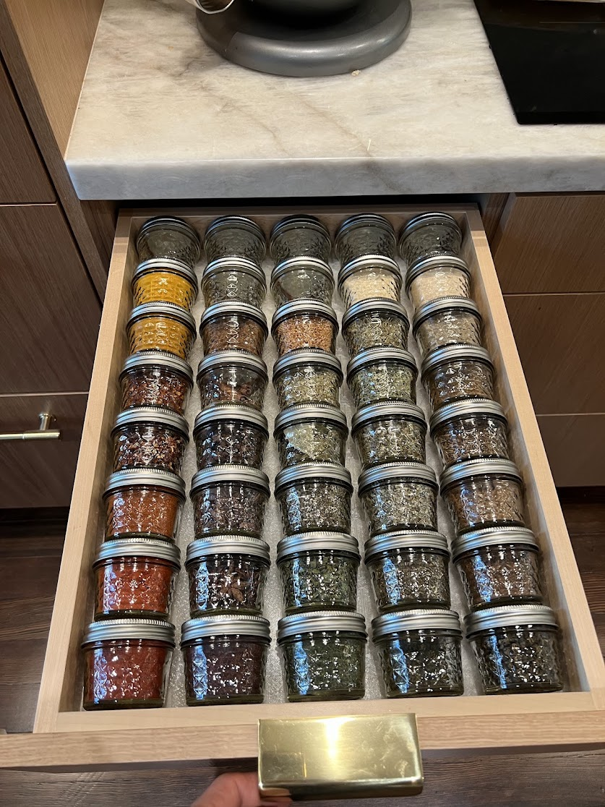
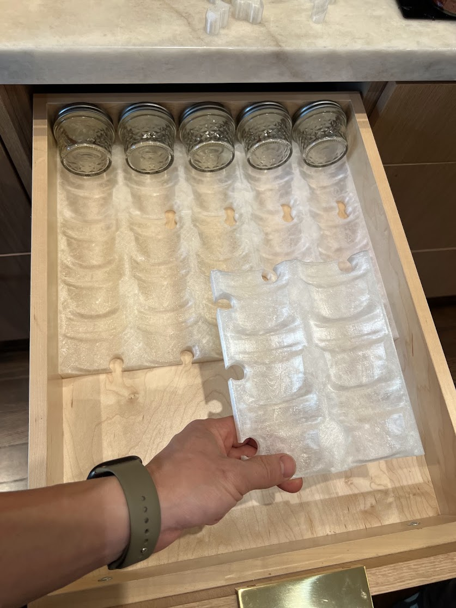
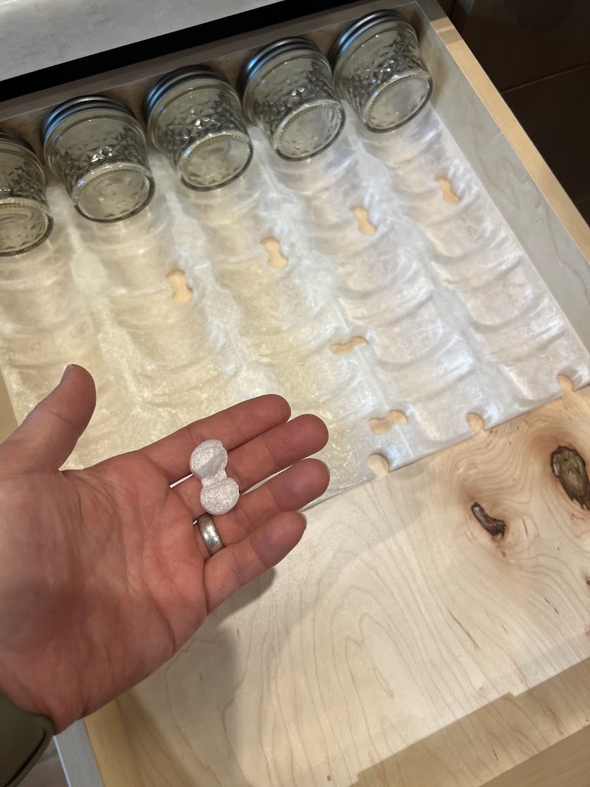

# Modular Spice Drawer Organizer

A continuous curved tray for a tightly packed spice drawer, split into panels
that fit a home 3D printer. Drop-in keys join the panels across the drawer and
front to back. The jars lift out individually.



Designed and printed by **JKim Makes** for **Ball 4 oz regular-mouth Quilted
Crystal jelly jars, SKU 1440080400**. The completed example holds **40 jars in a
5-column × 8-row grid**. Its tray is **378.7 × 499.7 mm** (14.91 × 19.67 in),
about **20.1 mm** tall; the nominal loaded height is **76.2 mm / 3.00 in**.

## Print an existing layout

Download the ready-to-print ZIP from the [Releases](https://github.com/jkimmakes/spice-drawer-organizer/releases) page and
follow its `PRINT_PLAN.md`. The tested 5×8 set contains the actual accepted
panels, the current **X3 and Y4** keys, quantities, an assembly map and checksums.

The photographs show the completed drawer and how its panels join:





## Generate a layout for your drawer

Measure the **inside** width and depth of the drawer and the available height
with it closed. The generator uses those dimensions, your printer bed and brim
size to choose a grid and divide it into printable modules. It produces a part
list, connector quantities, an assembly map, STLs and connector print plates.

The supported jar profile has a fixed **75.8 × 62.5 mm** pitch and **1.5°** jar
tilt. Drawer sizes, grid counts, module sizes and outside socket policy are
configurable. Other jar shapes and different packing pitches need another
profile; changing the STL scale would change the fit of both jars and keys.

Clone the repository and open its directory. Planning needs Python 3.10 or newer:

```sh
python3 -m spice_drawer plan \
  --drawer-width 379.2 --drawer-depth 502.7 \
  --bed-width 250 --bed-depth 210 \
  --out build/my-drawer
```

Open `build/my-drawer/PRINT_PLAN.md` and `assembly.svg` to review the result.
This example selects 5×8, six panels, eight X keys and ten Y keys.

To build STLs, install the Python build dependency and [OpenSCAD](https://openscad.org):

```sh
python3 -m pip install -e '.[build]'
python3 -m spice_drawer build build/my-drawer
python3 -m spice_drawer verify build/my-drawer
```

If OpenSCAD is outside your command path, pass its executable explicitly:

```sh
python3 -m spice_drawer build build/my-drawer \
  --openscad /Applications/OpenSCAD.app/Contents/MacOS/OpenSCAD
```

The verifier accepts the same `--openscad` option. The source includes its
required profile assets; a fresh checkout can build without any prior local
STLs or development directory.

For inches, use `--units in` with the dimension flags. JSON configurations use
millimetres throughout. See [the 5×8 configuration](examples/drawer_5x8.json) and
[a smaller drawer](examples/small_drawer.json):

```sh
python3 -m spice_drawer plan --config examples/small_drawer.json --out build/small
```

### Universal or drawer-specific

**Universal** is the default. Every module has female sockets on all four
edges, so it can move within the grid or accept an extension. The generator
includes flush plugs for unused sockets along the drawer perimeter. Remove a
plug to add another panel.

Use `--track drawer-specific` to put sockets only at joins needed for the
selected layout. Outside edges are solid and require no plugs. Every part
keeps the same orientation: lids and underside arrows point toward the back.

`--columns` and `--rows` request an exact grid. The planner rejects a grid that
does not fit. `--max-module-columns` and `--max-module-rows` limit each panel to
1–3 cells per direction. Printer dimensions include space for the configured
brim. Balanced panel divisions avoid thin final strips where possible.
`--clearance` specifies the **total** spare width and depth, rather than a
clearance per side; its default is 0.5 mm. Increase it for an uneven drawer.

## Print and assemble

Start with one panel and a key to check your printer and jars. Print flat at
**100% scale**, with **supports off**. The example uses 0.30 mm layers, a
0.20 mm first layer, two walls, 5% grid infill, four top / three bottom layers
and a 3 mm brim. Slice for your own printer and filament.

Align panels on the drawer floor. Insert keys from above with their flat
bottoms down. Arrows underneath the panels and keys point toward the lids and
drawer rear. X keys join side-by-side panels; Y keys join rows. Fill the outside
sockets of universal modules with the matching left/right/front/back plugs.
Lay each jar with its glass bottom toward the drawer front and lid toward the
rear. [Assembly and cleaning](docs/assembly.md) covers removal and fit checks.

Print each module file as many times as the quantity table says. Connector
plates are an alternative to the individual key/plug quantities: print each
plate once. The generator splits large connector sets across bed-sized plates.

## What has been tested

The completed 5×8 drawer in the photos was physically assembled and reported
to fit and function well, including the corrected Y keys. Its front-left panel
is the accepted R2 version; the other panels use the smoother R4 surface.
The ready-to-print tested set preserves those exact panels.

Generated layouts use the same R4 skin, R2 boundary contours and X3/Y4
interfaces. Automated checks cover closed printable meshes, dimensions,
modeled jar fit and vertical removal, and actual connector insertion at the
chosen panel joins. New drawer dimensions and printer/material combinations
still need the one-panel fit check. The jar measurements were obtained with
printed gauges and a ruler, so they describe an approximate fit envelope.

Run the planner tests with:

```sh
python3 -m unittest discover -s tests -v
```

The design assets and fitting model are described in
[the profile notes](docs/design.md). This project is independent of Ball and
OpenSCAD; their names identify the compatible jars and software.

## License

License selection is pending. Personal printing is the intended use of this
release; commercial print and source-redistribution terms will be stated here
when selected by the author.
