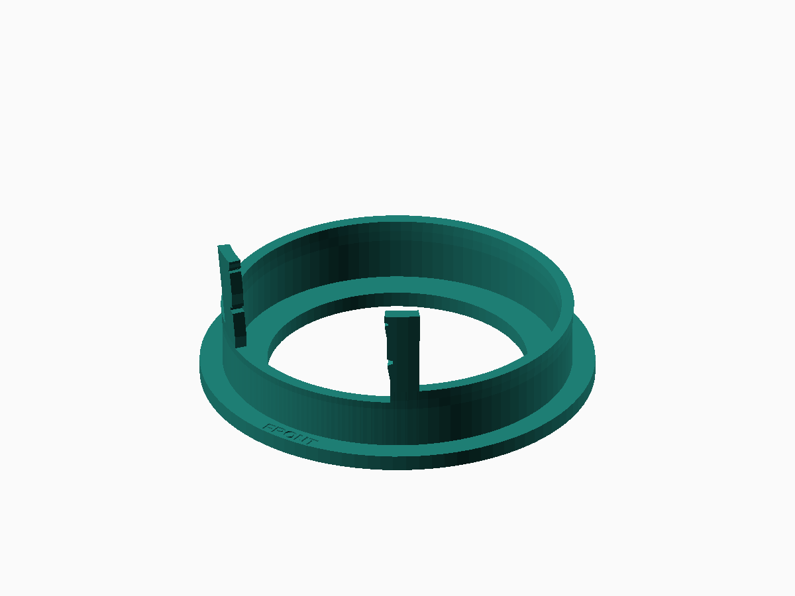
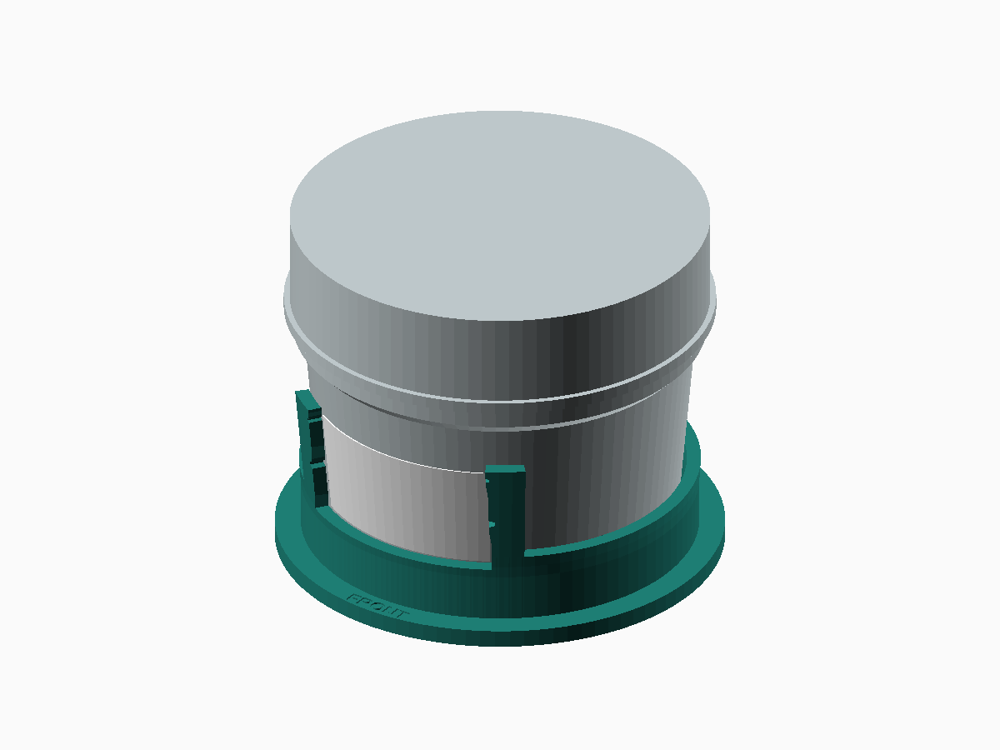

# Label placement jig

This one-piece guide locates a Ball 4 oz Quilted Crystal jar and sets the
height of its label. Lower the jar into the circular base, line up its oval
panel with the opening, and use the lower ledge and side marks to place the
label. The base and guide are printed together.



Download **[ball_4oz_label_jig.stl](../accessories/label-jig/ball_4oz_label_jig.stl)**.
Print one, flat as supplied at **100% scale, supports off**. The footprint is
76 mm in diameter and the overall height is 32.5 mm.

## Print settings

For a 0.4 mm nozzle, start with PLA, **0.20 mm layers**, a 0.20 mm first layer,
three perimeters, 15% infill, and four top and bottom layers. Use your usual
PLA temperature, cooling and speed profile. A brim is optional if needed for
bed adhesion; none is used for the estimate saved with the STL.

PrusaSlicer 2.9.6 estimates **1 h 2 min and 14.53 g PLA** on an MK3S with
those settings. The [saved estimate](../accessories/label-jig/slicer-estimate.json)
records the profile choices. This is an estimate rather than a measured print.

This is the circular base and low guide from the earlier clamping prototype,
with its tall supports and clamping parts removed. The side mounting feet
are also removed to leave a circular footprint. The jar seating surface,
guide opening, and label height are retained. The cleaned-up print still
needs a physical fit check.

## Place a label

1. Place the jig on a flat surface, with `FRONT` facing you. Lower a jar into
   the cup until its glass bottom rests on the built-in seating ring.
2. Rotate the jar until its oval panel is centered in the opening. Hold the
   jar and base steady together while applying the label.
3. With the backing still attached, check the first label against the lower
   ledge and side guides. The larger side notches mark the label center;
   the smaller ones mark its upper edge.
4. Peel the backing, align the label's bottom edge to the ledge, tack its
   center onto the glass, then smooth outward. Keep adhesive clear of the
   printed guide.
5. Lift the jar straight up through the open top and finish smoothing the
   label. Repeat with the next jar.

The guide is sized for the **35 × 18 mm** labels in the
[label-printing guide](label-printing.md). The jar's reported oval extends
from approximately 5 to 32 mm above its flat glass bottom. The label center
is therefore **18.5 mm** above that bottom, with its lower and upper edges
at **9.5 and 27.5 mm**. The 3 mm floor is already included in the design;
no loose spacer is needed.

The cup locates the jar but lets it rotate. Align the oval visually and hold
the jar during application. A nonslip mat under the entire jig can help on
a slick counter without changing the label height relative to the jar.



## Source and checks

The [OpenSCAD source](../spice_drawer/cad/label_jig.scad) exposes the label
dimensions, height, wall thickness and radial clearance. The tapered body
uses the measurements in the [organizer design notes](design.md), with
0.65 mm nominal radial clearance and relief near the rounded foot. The
reference omits quilting and the precise oval shape.

From the repository root, rebuild with:

```sh
python3 tools/build_label_jig.py
```

The tool checks that the STL is a single closed, consistently wound part
resting on the print bed. It also checks jar seating, sampled vertical
loading/removal and clearance for a 0.25 mm thick reference label, using
58–60 mm capped jar heights. Results and file checksums are saved in
[verification.json](../accessories/label-jig/verification.json). These checks
cover the modeled geometry; fit and handling need a trial on an actual jar.
