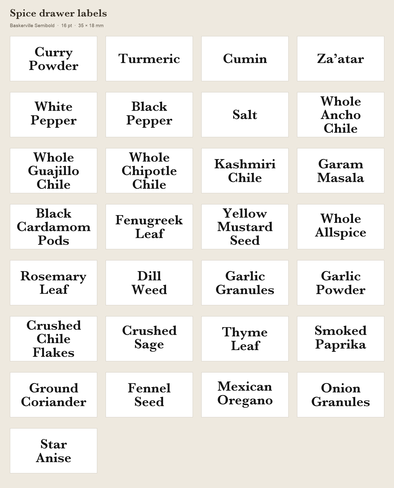

# Print the spice labels

The labels use **Baskerville SemiBold, 16 pt**, centered on **35 × 18 mm
rectangles with no border**. The library contains **40 editable labels**:
the original 29-spice set printed on 2026-10-18 and 11 additions printed on
2026-10-20, including MSG. Printing used a Brother PT-D410 and 18 mm laminated tape. Compact batches
put the labels beside one another on continuous tape, reducing the feed
allowance between separate print jobs.

## Files and settings

- [Individual labels](../labels/ready/): 40 editable P-touch Editor `.lbx`
  files, also usable as templates for new names. The
  [catalog](../labels/catalog.json) lists all names and line breaks.
- [Original compact batches](../labels/compact-batches/): four jobs, with a
  [manifest](../labels/compact-batches/batch-manifest.json) recording their
  contents, order and cut options.
- [Additional compact batches](../labels/compact-batches/additions-2026-10-20/):
  two five-label jobs, with a
  [manifest](../labels/compact-batches/additions-2026-10-20/batch-manifest.json).
- [Print settings](../labels/print-settings.json): dimensions, typography,
  native placement coordinates and print-dialog choices.
- [Recorded fit checks](../labels/fit-check.json): names, deliberate line
  breaks and measured fit for the original set. The
  [additional fit checks](../labels/fit-check-additions-2026-10-20.json)
  cover the 11 later labels, including MSG.

| Setting | Value |
| --- | --- |
| Printer / connection | Brother PT-D410 over USB |
| Software used | P-touch Editor 5.3.24 for macOS |
| Tape | 18 mm laminated, black text on white |
| Label | 35 mm long × 18 mm tape width, fixed length, landscape |
| Shape | Rectangle, no border or printed oval |
| Typeface | Baskerville SemiBold, 16 pt; native weight 600 |
| Alignment | Centered horizontally and vertically |
| Text frame | Approximately 31.04 × 15.8 mm |
| Line / character spacing | Native line spacing `-30` by default; character spacing `0` |
| Automatic shrinking / wrapping | Off; explicit line breaks |
| Margin displayed in Editor | 2 mm |

The labels fit within the jars' approximately 2 × 1 in oval panels. The
[placement jig](label-jig.md) sets their height. Baskerville must be available
on the computer; the font itself is not included. Check for font substitution
when opening the templates on another system.

The original 29 names passed the recorded fit checks at 16 pt. The three-line
Black / Cardamom / Pods layout measured approximately 30.13 mm wide and
14.92 mm in ink height. Check new names individually before printing; keep
the shared font size and adjust the wording or line breaks as needed.

The 11 additions also retain 16 pt and fit the saved text width. Green /
Sichuan / Peppercorn uses slightly tighter native line spacing, **`-40`**,
to keep the descenders inside the frame. That exception is saved in its
individual file, compact batch and print settings. The other labels use
`-30`. The new layouts were inspected in P-touch Editor before printing.

## Add or reprint one spice

1. Open [Cumin](../labels/ready/cumin.lbx) for a one-line layout,
   [Ground Coriander](../labels/ready/ground-coriander.lbx) for two lines, or
   [Black Cardamom Pods](../labels/ready/black-cardamom-pods.lbx) for three.
2. Save a copy under a new name and change the text. Preserve the fixed
   label and frame dimensions, 16 pt font, alignment and line spacing.
3. Check every line for clipping and the full label for vertical fit, with
   automatic shrinking off. Retain distinctions such as garlic granules
   versus powder or fenugreek leaf versus seed.
4. For one reprint, select one copy and turn **Chain Printing off** so the
   printer feeds the label out at the end. For multiple labels, use the
   compact procedure below.

## Print compact batches

Each job holds up to **8 labels at a 35 mm pitch**, with 3 mm trim allowance
at each end and small cut marks along the tape's upper and lower edges.
Scissors separate the labels at those marks; the finished labels are
borderless. Native pitch is 99.2 pt, so total job length is
`count × 99.2 pt + 6 mm`. Eight-label jobs display as 286 mm in Editor;
the five-label job displays as 181 mm. Keep jobs within the D410's 300 mm
length limit.

Cut options are **Print-dialog choices**. Check them each time; the saved
`.lbx` layout does not guarantee those options are selected.

| Print-dialog option | Intermediate jobs | Final or only job |
| --- | --- | --- |
| Copies | 1 | 1 |
| Pause to cut | Off | Off |
| Chain Printing | **On** | **Off** |
| Special Tape (No Cut) | Off | Off |
| Mirror Printing | Off | Off |

1. Load the tape, connect USB and turn the printer on. Its LCD must be
   awake; AA batteries worked for this print session.
2. Send the jobs in order, once each. Let each finish before sending the
   next and leave the tape uncut between jobs.
3. If the printer asks **“Start feeding?” between jobs**, press **Esc** to
   return to text entry without feeding.
4. For the final job, turn **Chain Printing off** to feed the last content
   past the cutter. If “Start feeding?” appears after that job, press **OK**
   and wait for feeding to finish.
5. Once printing and feeding stop, detach the strip with the printer's
   cutter, then use scissors at the small cut guides to separate the labels.

The printer can switch off while idle. If Editor reports that it cannot
communicate, wake the LCD before retrying and check the USB data connection.

The original 29-label run:

| Job | File | Labels | Editor length | Chain Printing |
| --- | --- | ---: | ---: | --- |
| 1 | [Batch 1](../labels/compact-batches/batch-01-of-04-8-labels.lbx) | 8 | 286 mm | On |
| 2 | [Batch 2](../labels/compact-batches/batch-02-of-04-8-labels.lbx) | 8 | 286 mm | On |
| 3 | [Batch 3](../labels/compact-batches/batch-03-of-04-8-labels.lbx) | 8 | 286 mm | On |
| 4 | [Batch 4](../labels/compact-batches/batch-04-of-04-5-labels.lbx) | 5 | 181 mm | **Off** |

## Additional labels printed on 2026-10-20

| Label | Saved line breaks |
| --- | --- |
| Chile Molido | Chile / Molido |
| Lajiao Mian | Lajiao / Mian |
| Cinnamon | Cinnamon |
| Sumac | Sumac |
| Oregano | Oregano |
| Bay Leaves | Bay / Leaves |
| 7 Spice (Baharat) | 7 Spice / (Baharat) |
| Green Sichuan Peppercorn | Green / Sichuan / Peppercorn |
| Cumin Seed | Cumin / Seed |
| Basil | Basil |
| MSG | MSG |

The first ten were printed as two compact jobs:

| Job | File | Labels | Editor length | Chain Printing |
| --- | --- | --- | ---: | --- |
| 1 | [Additional batch 1](../labels/compact-batches/additions-2026-10-20/new-spices-1-of-2-5-labels.lbx) | Chile Molido through Oregano | 181 mm | On |
| 2 | [Additional batch 2](../labels/compact-batches/additions-2026-10-20/new-spices-2-of-2-5-labels.lbx) | Bay Leaves through Basil | 181 mm | **Off** |

[MSG](../labels/ready/msg.lbx) was printed separately, one copy with Chain
Printing off. The [print history](../labels/print-history-additions-2026-10-20.json)
records both completed batch jobs and that single-label print.

## Brother references

- [PT-D410 user guide](https://support.brother.com/g/s/es/htmldoc/ptouch/d410/uken/PDF/PDF.pdf):
  “Start feeding?” and OK/Esc behavior.
- [P-touch Editor cut options](https://download.brother.com/pub/com/p-touch6-help/en-US/help/printing/cut_option/cut_option.html):
  Chain Printing and final feeding.
- [PT-D410 label length](https://support.brother.com/g/s/es/htmldoc/ptouch/d410/usen/html/GUID-6A2B2101-2E7F-42EE-9A1D-C7356E2CAB5D_47.html?c=us&lang=en&prod=d410eus):
  30–300 mm range.
